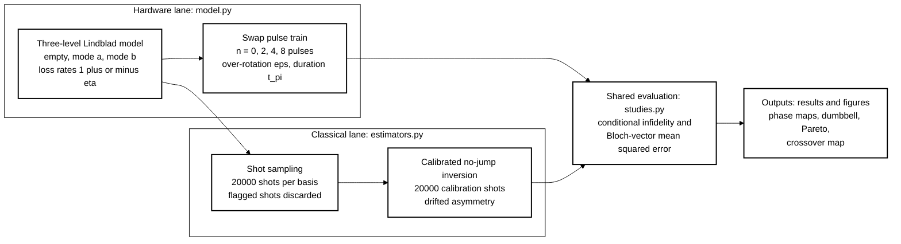
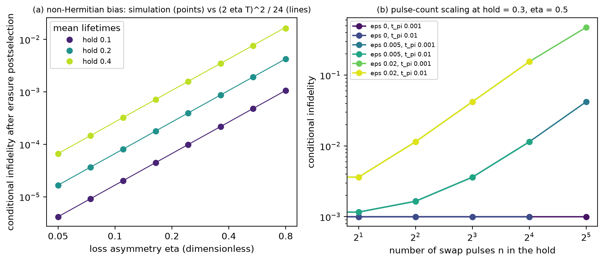
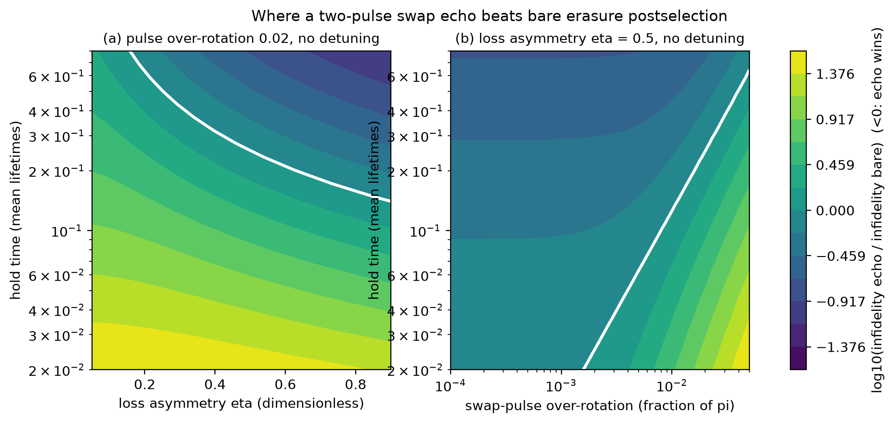
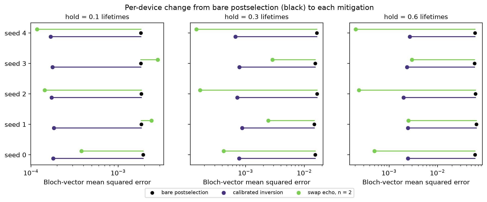
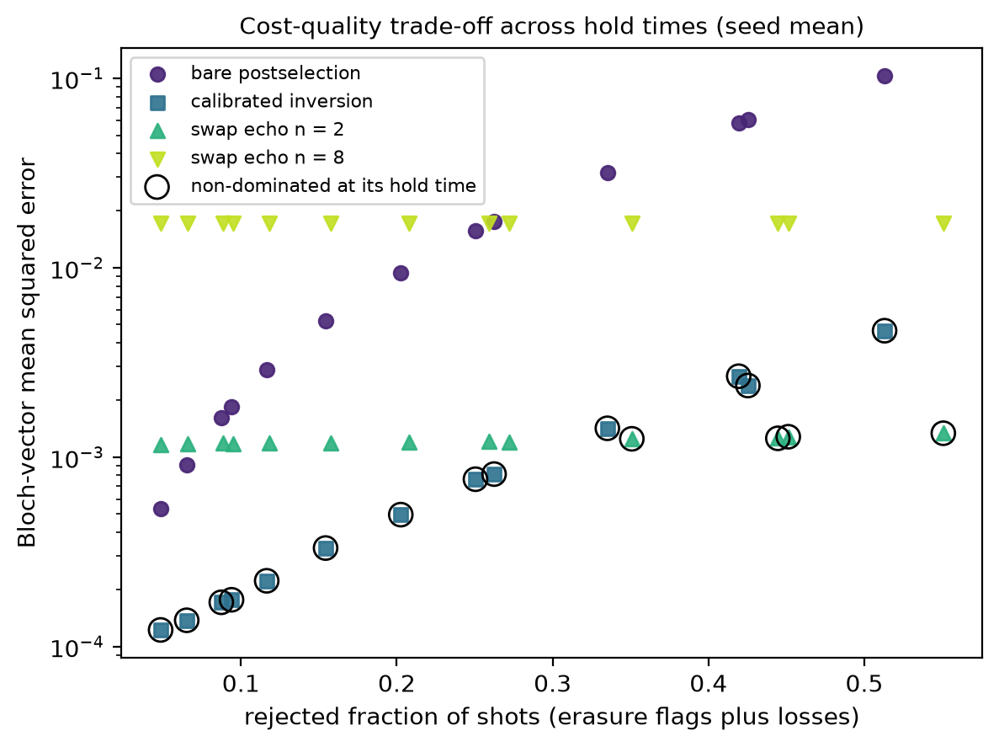
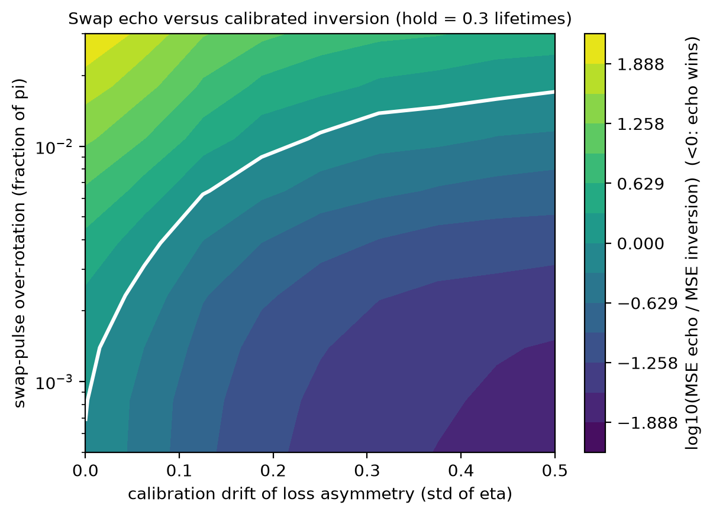

# Erasure-Invisible Loss-Asymmetry Bias in a Dual-Rail Memory: Swap Echo versus Classical Inversion

[](LICENSE)
[](pyproject.toml)
[](https://github.com/pradeepdegalaroyal/dual-rail-erasure-bias-swap-echo-vs-inversion/actions/workflows/ci.yml)

## Abstract

Erasure qubits turn excitation loss into flagged events, but when the two modes of a dual-rail
qubit decay at different rates, the shots that survive postselection carry a residual, unflagged
error that grows with hold time. This simulation study derives and verifies its scaling (infidelity of
(2 eta T)^2 / 24), then compares two mitigations: a periodic swap echo that averages the two loss rates
(a Floquet-style effective Hamiltonian) and classical inversion of the known no-jump map. Under
shot noise, calibration drift and pulse error, calibrated inversion is the better default; the swap
echo wins only for accurate pulses and long holds or large calibration drift, and the boundary is
mapped.

## Motivation

Fault-tolerant superconducting architectures increasingly rely on erasure conversion, because a
flagged error is much cheaper to correct than an unflagged one. The accepted shots are then treated
as error free with respect to loss. Conditioning on "no loss" is however a non-Hermitian operation:
the effective Hamiltonian of the no-jump trajectory is non-Hermitian (Gong et al., 2018,
doi:10.1103/PhysRevX.8.031079), and if the two modes decay at different rates the accepted state is
pulled toward the longer-lived mode. Periodic driving defines a time-averaged effective Hamiltonian
(Oka and Kitamura, 2019, doi:10.1146/annurev-conmatphys-031218-013423), so a periodic mode exchange
is a natural hardware remedy. The engineering context, in which noise and control set the error budget
of superconducting qubits, is that of Krantz et al. (2019, doi:10.1063/1.5089550).

## Research gap

The supplied literature (nine papers; see `docs/RESEARCH_GAP.md` for the related-work table) gives the
non-Hermitian and Floquet tools and the device-variation concerns of the reviews, but no quantitative
error budget for the conditional state of a postselected two-mode memory, and no comparison of a
hardware echo with classical post-processing when calibration drifts. Related work by the author on
erasure-aware error correction is in
[imperfect-erasure-flag-decoding-toric-code](https://github.com/pradeepdegalaroyal/imperfect-erasure-flag-decoding-toric-code)
and on error-correction margins in
[repetition-code-breakeven-map](https://github.com/pradeepdegalaroyal/repetition-code-breakeven-map);
this study addresses the single-memory conditional-error term that those do not model.

## What is new here

* A closed-form, numerically verified scaling for the erasure-invisible bias of an asymmetric-loss
  dual-rail memory.
* A head-to-head comparison of a hardware (swap echo) and a classical (calibrated inversion)
  remedy at equal total hold time, with shot noise, calibration shots and calibration drift all charged.
* Phase maps of where each remedy wins, in pulse error, drift, asymmetry and hold time.

## Hypotheses

* **H1.** The mean conditional infidelity over the six Pauli inputs is (2 eta T)^2 / 24 (eta: loss
  asymmetry, T: hold time in mean lifetimes) when dephasing is off.
* **H2.** A two-pulse swap echo removes the bias exactly for ideal pulses and beats bare
  postselection only below a pulse over-rotation boundary that depends on hold time.
* **H3.** With fresh calibration, classical inversion matches or beats the echo; the echo wins only
  when the asymmetry drifts after calibration by more than a threshold and the pulses are accurate.

## Method



Legend: Lindblad = open-system master equation; eta = loss asymmetry; eps = fractional pulse
over-rotation; t_pi = pulse duration; Pareto = non-dominated set of cost-quality points.

A dual-rail qubit is one excitation in two modes; the empty state is the erased state. Mode loss rates are
1 + eta and 1 - eta (units of the mean lifetime), with differential dephasing (0.01 by default), optional
quasi-static detuning, and swap pulses that suffer loss and over-rotation. A hold of fixed total
duration uses Carr-Purcell-Meiboom-Gill (CPMG) spacing so every method sees the same decay. Compared:
(i) bare erasure postselection (standard baseline), (ii) classical inversion of the no-jump map from
calibration shots (classical baseline; an oracle variant isolates shot noise), (iii) swap echo with
n = 2, 4, 8 pulses. Metrics are exact conditional infidelity and shot-limited Bloch-vector
mean squared error (MSE). Details: `docs/METHOD.md`.

## Results

All numbers below are read from `results/`; MSE values are mean ± standard deviation over 5 seeds
(each seed draws its own pulse over-rotation from a normal distribution with standard deviation 0.01;
200 repetitions with calibration drift of 0.1 in eta per seed).

### H1: the bias follows (2 eta T)^2 / 24

Fitted log-log slopes of infidelity against eta are 1.999, 1.997 and 1.988 for hold times 0.1, 0.2
and 0.4 (`results/h1_summary.json`). The ratio of simulation to formula lies between 0.959 and
1.000 (largest deviation 4.1 percent, attributable to higher-order terms in eta T).
H1 is supported.



*Figure 5. The non-Hermitian bias follows its quadratic law (a), and every extra swap pulse adds coherent
error that eventually exceeds the bias (b).*

### H2: the echo removes the bias, at a pulse-error price

With ideal pulses the echo removes the bias exactly (conditional infidelity 9.99e-4 at hold 0.3, which is
the dephasing floor, against 4.70e-3 for bare postselection; `results/ablation_components.csv`). With
over-rotation 0.01 the echo infidelity is 1.65e-3; finite pulse duration alone changes nothing visible
(9.99e-4). With quasi-static detuning (standard deviation 1.0) bare postselection degrades to 1.92e-2
while the full echo stays at 1.66e-3, but that gain is the textbook echo effect and not the
loss-asymmetry term this study isolates. The echo is better than bare postselection in 27.0 percent of the
(asymmetry, hold) grid at over-rotation 0.02; at asymmetry 0.9 the first grid hold time where it wins is
0.147, at asymmetry 0.475 it is 0.273. In the (over-rotation, hold) plane the largest over-rotation at which the
echo still wins is 0.0013 at hold 0.02, 0.0082 at hold 0.126 and 0.05 (grid edge) at hold 0.8.



*Figure 1. The echo wins (white contour = break-even) only above a hold time that falls with
asymmetry, and only below a pulse over-rotation that rises with hold time.*

Pulse count matters: at over-rotation 0.005 and pulse duration 0.001 the infidelity is 1.16e-3 for
n = 2, 3.62e-3 for n = 8 and 4.22e-2 for n = 32, so more pulses are harmful once the pulses are imperfect
(`results/pulse_count_scaling.csv`). H2 is supported.

### H3: echo versus calibrated inversion under shots and drift

Bloch-vector MSE (20000 shots per basis and 20000 calibration shots):

| Hold (lifetimes) | Bare postselection | Calibrated inversion | Oracle inversion | Swap echo n = 2 | Swap echo n = 4 | Swap echo n = 8 |
|---|---|---|---|---|---|---|
| 0.1 | 1.85e-3 ± 4.7e-5 | 1.76e-4 ± 6.1e-6 | 1.12e-4 ± 2.1e-6 | 1.18e-3 ± 1.3e-3 | 4.37e-3 ± 5.3e-3 | 1.71e-2 ± 2.1e-2 |
| 0.3 | 1.56e-2 ± 6.9e-4 | 7.63e-4 ± 7.5e-5 | 1.45e-4 ± 2.8e-6 | 1.21e-3 ± 1.3e-3 | 4.40e-3 ± 5.3e-3 | 1.71e-2 ± 2.1e-2 |
| 0.6 | 6.03e-2 ± 2.1e-3 | 2.38e-3 ± 2.5e-4 | 2.26e-4 ± 5.3e-6 | 1.28e-3 ± 1.3e-3 | 4.49e-3 ± 5.4e-3 | 1.72e-2 ± 2.1e-2 |

Calibrated inversion cuts the bare error by a factor of about 10 (hold 0.1), 20 (0.3) and 25 (0.6). The echo's
large standard deviation across seeds comes from the per-device over-rotation: it beats
inversion in 2 of 5 seeds at hold 0.1, 3 of 5 at hold 0.3 and 3 of 5 at hold 0.6, always the seeds with
the smallest over-rotation. On the seed mean, inversion is better at holds 0.1 and 0.3 and the echo is
better at hold 0.6 (1.28e-3 against 2.38e-3). The echo costs acceptance: 0.549 against 0.575 at
hold 0.6 (`results/h3_methods_per_seed.csv`).



*Figure 2. Per device, both mitigations improve on bare postselection almost everywhere; the echo is
the larger improvement only for devices with small pulse error.*

Across 13 hold times, calibrated inversion is non-dominated in cost and quality at every one, and
the two-pulse echo joins the front at the four longest holds (0.43 and above); bare postselection and the
eight-pulse echo are never on the front (`results/h3_pareto_table.csv`).



*Figure 3. Rejected fraction is set mainly by hold time, so the front is read within a hold time:
inversion dominates until the hold is long enough that the echo's flat error wins.*

At hold 0.3 the echo beats inversion in 51 of 81 cells of the (drift, over-rotation) map. With no
drift the echo never wins by more than noise (at over-rotation 5e-4 the two MSEs are 1.44e-4 and
1.51e-4). At over-rotation 0.0039 the echo needs a drift of at least 0.125 and at 0.0108 at least 0.25;
at 0.018 and above it never wins within the drift range 0 to 0.5.



*Figure 4. Echo versus calibrated inversion: the echo wins only for accurate pulses and large
calibration drift.*

H3 is partly supported. The ordering with fresh calibration and the dependence on drift and pulse error
are as predicted; however, at the longest hold with the default drift of 0.1 the echo already wins on
the seed mean, so "inversion is the better default" holds for short and medium holds only.

### Negative and caveat results

* The bias is second order in the infidelity, so dephasing buries it at short holds: its share of the
  bare error is 56 percent at hold 0.1 with dephasing rate 0.01, and only 6 percent at hold 0.1 with
  dephasing rate 0.2 (15 percent at hold 0.3; `results/dephasing_sweep.csv`).
* The eight-pulse echo is worse than doing nothing at the shorter holds (1.71e-2 against 1.85e-3 at 0.1).
* Calibration drift hurts inversion more as the hold grows: with drift 0.1 at hold 0.6 its error is
  2.38e-3 against 2.26e-4 for the oracle that knows the true asymmetry.

## Discussion

Erasure postselection hides a loss-asymmetry error that is small per cycle but grows quadratically
with hold time and asymmetry, and it is invisible to the flags. If its calibration is trusted, the
cheapest fix is classical: the bias is a known non-unitary map, and inverting it costs no hardware
time. The swap echo is robust to calibration drift, which inversion is not, but it pays for that with
coherent pulse errors that grow with pulse count and with a few percent of acceptance. For a lab
the practical rule from the maps is to recalibrate the loss asymmetry often (inversion) unless
pulse over-rotation is below a few parts in 1000 and the asymmetry wanders by more than about 0.1.

## Limitations

* A three-level single-excitation model with independent Markovian loss and dephasing; no
  cross-talk, no leakage, no non-Markovian or two-level-system noise, no multi-qubit gates.
* The inversion baseline assumes the no-jump map is the dominant conditional distortion; with
  strong detuning it is not enough alone, and echo and inversion are not combined here.
* Pulse error is a single fractional over-rotation applied identically to every pulse; real
  errors also include phase errors and detuning-dependent pulse shapes.
* Drift is modelled as a Gaussian shift between calibration and run, not as measured
  time series. Everything is dimensionless; no device-specific claim is made.
* Echo seed variability is large because only five over-rotation draws are used.

## Future work

Combine inversion with a short echo, fit the drift model to measured loss-rate time series, extend to
leakage and to a two-qubit logical gate, and test on hardware where mode-resolved loss rates and swap
pulse errors can be measured directly. In a lab setting, the quantities needed are exactly those that
a calibration routine already produces (per-mode survival) and the swap-pulse over-rotation.

## Reproducibility

```bash
pip install -r requirements.txt
python -m pytest -q                      # 9 tests, about 1 s
python experiments/run_all.py --quick    # smoke run, under 30 s
python experiments/run_all.py            # full study, 92 s (`results/run_meta.json`)
```

Hardware used: Windows 11 laptop, 16 threads, central processing unit (CPU) only (the study is
NumPy and SciPy; no graphics processing unit is needed). Python 3.11, numpy 2.2.6, scipy 1.17.1,
pandas 2.3.3, matplotlib 3.11.1. Raw results are written to `results/` as comma-separated values (CSV) or JSON
files and figures to `figures/` (200 dpi). The simulation is seeded; reruns reproduce the numbers above.

## Project structure

```
src/erasure_echo/model.py       Lindblad superoperators, pulse trains, exact metrics
src/erasure_echo/estimators.py  shot sampling, calibration, no-jump inversion
src/erasure_echo/studies.py     the experiments (maps, methods, ablation, sweeps)
src/erasure_echo/figures.py     figure generation
experiments/run_all.py          one-command reproduction (--quick for a smoke run)
tests/                          fast tests, including a trajectory cross-check
docs/RESEARCH_GAP.md, docs/METHOD.md
results/, figures/
```

## Citation

```bibtex
@software{degala_erasure_bias_swap_echo_2026,
  author  = {Degala, Chenchupradeep},
  title   = {Erasure-Invisible Loss-Asymmetry Bias in a Dual-Rail Memory: Swap Echo versus Classical Inversion},
  year    = {2026},
  version = {0.1.0},
  url     = {https://github.com/pradeepdegalaroyal/dual-rail-erasure-bias-swap-echo-vs-inversion},
  license = {MIT}
}
```

MIT (Massachusetts Institute of Technology) license (`LICENSE`). Citation metadata is also in `CITATION.cff`.
